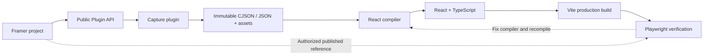

# Framer to React

**Capture once. Compile anywhere.**

An open-source developer tool that turns a Framer design into a portable archive and a readable, independently runnable React application. It is not a hosted service, a screenshot-to-code generator, or an official Framer product.

[English](README.md) · [Español](docs/es/README.md) · [简体中文](docs/zh-CN/README.md) · [हिन्दी](docs/hi/README.md) · [العربية](docs/ar/README.md)

[](https://github.com/caleb-media-studio/framer-to-react/actions/workflows/ci.yml) [](LICENSE)

## What it does

- **Capture:** read the public Framer Plugin API and archive page trees, layer IDs, responsive variants, reusable definitions, original code files, styles, available SVGs, fonts and images.
- **Compile:** transform the archive into React + TypeScript, with route directories, shared layouts, reusable canvas components, imported original code components, semantic controls and local assets.
- **Verify:** compare the rendered application against an authorized published reference using Playwright. Missing or ambiguous source data is reported, not treated as a match.

The capture plugin and compiler are separate. Changing the compiler does not require recapturing the design.

## Architecture



The archive is the source of record. The compiler reads it without an editor session or a network connection. The archive is the only compiler input. Published references are used only for verification. Missing data requires a new capture, not a patch to the archive.

## Quick start

Requirements: Bun 1.4+ (preferred) or Node.js 22.18+ with npm. Clone the repository:

```sh
git clone https://github.com/caleb-media-studio/framer-to-react.git
cd framer-to-react
bun install --frozen-lockfile
bun run dev
```

Use the local development URL in Framer's plugin development workflow. In the plugin, choose the project, folder or selection and leave **Compress source JSON (CJSON + reference dictionary)** enabled. Download the ZIP. The plugin development bundle is built with `bun run build`.

Compile the downloaded archive independently:

```sh
bun bin/framer-to-react.ts compile ./design.zip --out ./react-app
cd react-app
bun install
bun run dev
```

To check the production build, run `bun run build` in the generated application. With npm instead:

```sh
npm ci
node bin/framer-to-react.ts compile ./design.zip --out ./react-app
cd react-app
npm install
npm run build
npm run dev
```

Run these alternatives from the repository root using a new output directory. The compiler also accepts an extracted archive. It never overwrites an existing destination or mutates the input.

### CLI

```text
framer-to-react compile <design.zip|directory|design.cjson> --out <new-directory>
framer-to-react pack <design.zip|directory> --out <new.zip>
framer-to-react unpack <design.zip|directory|design.cjson> --out <new-directory>
framer-to-react --help
framer-to-react --version
```

Invoke the executable with Bun or Node as above, or link the local checkout with `npm link` to use the command name. No registry release is required.

## Archive standard and CJSON

The capture-only plugin writes design.cjson and design.cjsonref by default alongside original assets and code. The shared dictionary interns keys, object shapes and repeated strings. JSON values are preserved; whitespace is not. The public Plugin API has capture limitations; these are reported, not guessed. See [archive v6](docs/archive-v6.md), [CJSON/1](docs/cjson-v1.md) and [JSON schemas](schemas/). Benchmark an authorized capture with scripts/benchmark-cjson.ts.

## Generated application

```text
react-app/
├── src/
│   ├── components/
│   │   ├── canvas/      # reusable canvas components
│   │   └── code/        # original TSX / JSX modules
│   ├── layouts/         # shared layouts and template variants
│   ├── pages/           # route hierarchy and breakpoint modules
│   ├── routes.ts        # lazy route imports
│   └── styles.css
├── public/assets/      # captured local assets
├── compile-report.json
├── reuse-report.json
└── package.json
```

Code components are resolved by captured identifiers and exported names, not by screenshots. Their source files and property controls are preserved; a Framer compatibility adapter supports a subset of runtime APIs. The compiler does not invent backend behavior or install unknown dependencies.

Each route is loaded on demand with React lazy imports. Shared components and layout modules remain reusable across routes.

## Fidelity and limitations

This is early-stage open-source software. The Framer API does not expose every editor feature, and captured code can depend on Framer-specific runtime features. Font licensing, external assets, complex interactions, rich text, inherited templates and private or unpublished routes may require additional source data or manual work.

- A successful capture, successful TypeScript/Vite build and verified visual fidelity are **different** results.
- Inspect `compile-report.json`, `reuse-report.json`, `layout-report.json` when present, and the source diagnostics.
- Published comparison is opt-in; use only projects you are authorized to access.
- The fidelity goal is zero verified discrepancies under fixed tolerances with complete coverage. No claim of universal 100% parity is made.

See [the archive specification](docs/archive-v6.md), [the fidelity gate](verification/FIDELITY_GATE.md), and [contributing](CONTRIBUTING.md).

## Development

```sh
bun install --frozen-lockfile
bun run typecheck
bun run test
bun run build
```

All first-party executable source, including the plugin, compiler, renderer adapters, CLI, verification tools, examples and tests, uses strict TypeScript. Icon datasets remain JSON; captured third-party code is preserved unchanged. Node and npm remain supported. CI uses synthetic fixtures rather than private customer projects.

## License

MIT for the project's own code. Bundled icon data retains the original licenses and attributions in [third-party/](third-party/README.md). You retain responsibility for the rights to your exported project, fonts, images and other assets. Framer is a trademark of its respective owner. This project is independent and not endorsed by Framer.

