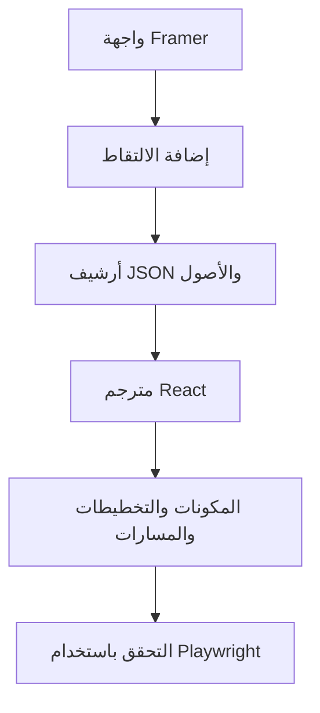

# Framer to React

[English](../../README.md) · [Español](../es/README.md) · [简体中文](../zh-CN/README.md) · [हिन्दी](../hi/README.md) · [العربية](README.md)

**التقط التصميم مرة واحدة، ثم حوّله حيثما تريد.**

أداة مفتوحة المصدر للمطورين تُحوّل تصميم Framer إلى أرشيف قابل للنقل وتطبيق React مستقل وقابل للتحرير. ليست خدمة مستضافة أو منتجًا رسميًا من Framer.

## آلية العمل

تستخدم الإضافة واجهة Framer العامة لالتقاط شجرة الطبقات والمعرّفات والمتغيرات المتجاوبة والمكونات وملفات الكود الأصلية والأنماط والأصول المتاحة. يبقى JSON الأصلي والأصول في أرشيف مستقل. يتحقق المترجم من الأرشيف ويولّد تطبيق React باستخدام TypeScript ومكونات وتخطيطات مشتركة ومسارات تُحمّل عند الحاجة. تقارن Playwright الناتج بموقع منشور مصرح باستخدامه.



## البدء

يُنصح باستخدام Bun 1.4 أو أحدث، مع دعم Node.js 22.18 أو أحدث وnpm.

```sh
git clone https://github.com/caleb-media-studio/framer-to-react.git
cd framer-to-react
bun install --frozen-lockfile
bun run dev
```

افتح الإضافة المحلية في بيئة تطوير إضافات Framer. اترك خيار **Raw design archive only** مفعّلًا ونزّل ملف ZIP.

```sh
bun bin/framer-to-react.mjs compile design.zip --out react-app
cd react-app
bun install
bun run build
bun run dev
```

عند استخدام npm، شغّل `npm ci` و`node bin/framer-to-react.mjs compile design.zip --out react-app` في مستودع الأداة. ثم شغّل `npm install` و`npm run build` و`npm run dev` في التطبيق الناتج.

تتضمن المخرجات `src/components/` و`src/layouts/` و`src/pages/` و`public/assets/`. تُستورد ملفات TSX الأصلية كمكونات فعلية بدل تحويلها إلى صور. ولا يُعدّل المترجم أرشيف الإدخال.

## الدقة والقيود

نجاح البناء لا يعني التطابق البصري الكامل. تُسجّل الأصول غير المتاحة والتفاعلات غير المدعومة والمراجع غير المؤكدة ضمن القيود. راجع `compile-report.json` وتقارير إعادة الاستخدام. استخدم فقط المشاريع التي تملك إذن الوصول إليها. واجهة المترجم وسطر الأوامر مكتوبان باستخدام TypeScript الصارم، ولا تزال بعض وحدات التصيير مكتوبة باستخدام JavaScript.

[مواصفات الأرشيف](../archive-v5.md) · [التحقق](../../verification/FIDELITY_GATE.md) · [المساهمة](../../CONTRIBUTING.md) · [ترخيص MIT](../../LICENSE).

