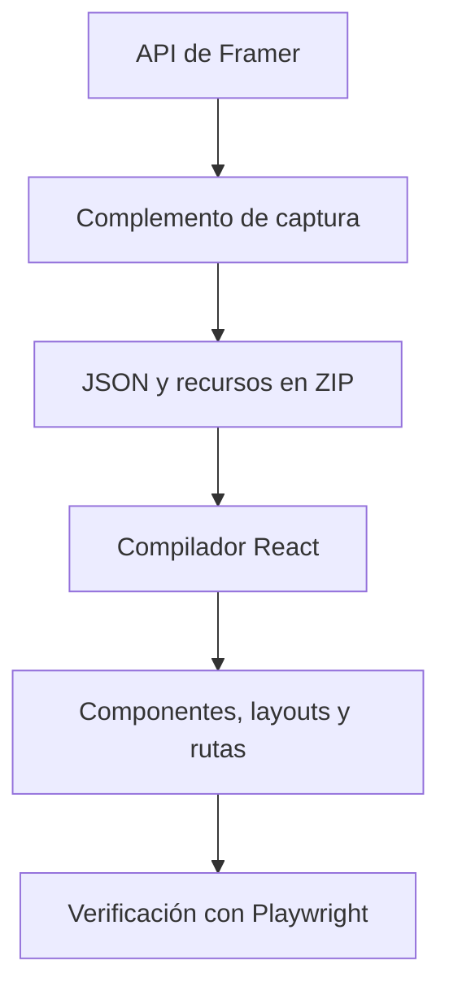

# Framer to React

[English](../../README.md) · [Español](README.md) · [简体中文](../zh-CN/README.md) · [हिन्दी](../hi/README.md) · [العربية](../ar/README.md)

**Captura una vez. Compila donde quieras.**

Herramienta de código abierto que convierte un diseño de Framer en un archivo portable y una aplicación React editable. No es un servicio alojado ni un producto oficial de Framer.

## Cómo funciona

El complemento utiliza la API pública de Framer para capturar árboles de capas, identificadores, variantes responsivas, componentes, archivos de código, estilos y recursos disponibles. El archivo JSON y los recursos se conservan como fuente original. El compilador independiente valida esos datos y genera React con TypeScript, componentes reutilizables, layouts compartidos y carga diferida por ruta. Playwright compara el resultado con una referencia publicada autorizada.



## Inicio rápido

Instala Bun 1.4+ (recomendado) o Node.js 22.18+ y npm.

```sh
git clone https://github.com/caleb-media-studio/framer-to-react.git
cd framer-to-react
bun install --frozen-lockfile
bun run dev
```

Abre el complemento local mediante las herramientas de desarrollo de Framer. Exporta el diseño con **Raw design archive only** activado. Después:

```sh
bun bin/framer-to-react.mjs compile design.zip --out react-app
cd react-app
bun install
bun run build
bun run dev
```

Con npm, usa `npm ci`, `node bin/framer-to-react.mjs compile design.zip --out react-app` y, en la aplicación generada, `npm install`, `npm run build` y `npm run dev`.

La salida incluye `src/components/`, `src/layouts/`, `src/pages/` y `public/assets/`. Los archivos TSX originales se importan como componentes, y las rutas se cargan cuando se necesitan. El compilador no modifica el archivo original.

## Verificación y límites

La compilación correcta no implica fidelidad visual completa. Los recursos inaccesibles, las interacciones no implementadas y las referencias ambiguas se registran como limitaciones. Consulta `compile-report.json` y los informes de reutilización. Solo utiliza proyectos y referencias que tengas autorización para acceder. El núcleo y la CLI están en TypeScript estricto; parte del renderizador sigue en JavaScript.

[Especificación del archivo](../archive-v5.md) · [Verificación](../../verification/FIDELITY_GATE.md) · [Contribuir](../../CONTRIBUTING.md) · [Licencia MIT](../../LICENSE).

