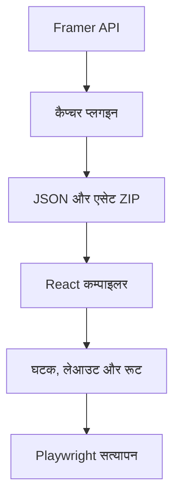

# Framer to React

[English](../../README.md) · [Español](../es/README.md) · [简体中文](../zh-CN/README.md) · [हिन्दी](README.md) · [العربية](../ar/README.md)

**एक बार कैप्चर करें, कहीं भी कम्पाइल करें।**

यह ओपन-सोर्स डेवलपर टूल Framer डिज़ाइन को पोर्टेबल आर्काइव और स्वतंत्र रूप से चलने वाले React ऐप में बदलता है। यह कोई होस्टेड सेवा या Framer का आधिकारिक उत्पाद नहीं है।

## यह कैसे काम करता है

प्लगइन Framer की सार्वजनिक API से लेयर ट्री, पहचानकर्ता, रिस्पॉन्सिव वेरिएंट, घटक, मूल कोड, स्टाइल और उपलब्ध एसेट कैप्चर करता है। मूल JSON और एसेट अलग आर्काइव में रहते हैं। स्वतंत्र कम्पाइलर इनपुट को जाँचकर TypeScript, पुनः उपयोग योग्य React घटक, साझा लेआउट और ज़रूरत के अनुसार लोड होने वाले रूट बनाता है। Playwright अधिकृत प्रकाशित वेबसाइट से तुलना करता है।



## शुरुआत

Bun 1.4+ अनुशंसित है। Node.js 22.18+ और npm भी समर्थित हैं।

```sh
git clone https://github.com/caleb-media-studio/framer-to-react.git
cd framer-to-react
bun install --frozen-lockfile
bun run dev
```

Framer के प्लगइन डेवलपमेंट वातावरण में स्थानीय प्लगइन खोलें। **Compress source JSON (CJSON + reference dictionary)** चालू रखकर डिज़ाइन ZIP डाउनलोड करें।

```sh
bun bin/framer-to-react.ts compile design.zip --out react-app
cd react-app
bun install
bun run build
bun run dev
```

npm के लिए टूल की डायरेक्टरी में `npm ci` और `node bin/framer-to-react.ts compile design.zip --out react-app` चलाएँ। फिर बने ऐप में `npm install`, `npm run build` और `npm run dev` चलाएँ।

आउटपुट में `src/components/`, `src/layouts/`, `src/pages/` और `public/assets/` शामिल हैं। मूल TSX को वास्तविक React घटक के रूप में आयात किया जाता है। इनपुट आर्काइव नहीं बदला जाता।

## सत्यापन और सीमाएँ

सफल बिल्ड का अर्थ पूरी दृश्य समानता नहीं है। अनुपलब्ध एसेट, असमर्थित इंटरैक्शन और अस्पष्ट संदर्भ रिपोर्ट में दर्ज होते हैं। `compile-report.json` देखें। केवल अधिकृत प्रोजेक्ट का उपयोग करें। प्लगइन, कम्पाइलर, रेंडरिंग, सत्यापन और परीक्षण सहित सभी प्रथम-पक्ष एक्जीक्यूटेबल कोड strict TypeScript में हैं।

[आर्काइव विनिर्देश](../archive-v6.md) · [सत्यापन](../../verification/FIDELITY_GATE.md) · [योगदान](../../CONTRIBUTING.md) · [MIT लाइसेंस](../../LICENSE)।


[CJSON/1](../cjson-v1.md) · [Archive v6](../archive-v6.md)
