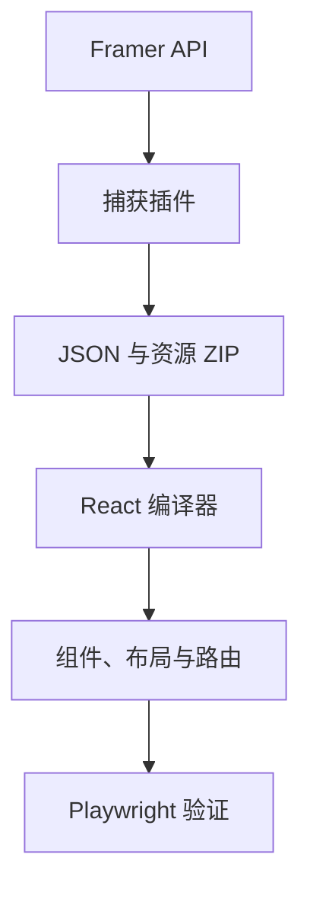

# Framer to React

[English](../../README.md) · [Español](../es/README.md) · [简体中文](README.md) · [हिन्दी](../hi/README.md) · [العربية](../ar/README.md)

**一次捕获，随处编译。**

这是一个开源开发工具，将 Framer 设计导出为可移植的设计档案，再编译成可编辑、独立运行的 React 应用。它不是托管服务，也不是 Framer 官方产品。

## 工作原理

插件通过 Framer 公开 API 捕获图层树、标识符、响应式变体、组件、原始代码、样式及可用资源。原始 JSON 和资源文件作为独立的设计档案保存。React 编译器验证档案，生成 TypeScript、可复用组件、共享布局和按路由延迟加载的模块。Playwright 可以将输出与经授权的已发布网站进行比较。



## 快速开始

推荐 Bun 1.4+；也支持 Node.js 22.18+ 与 npm。

```sh
git clone https://github.com/caleb-media-studio/framer-to-react.git
cd framer-to-react
bun install --frozen-lockfile
bun run dev
```

在 Framer 的插件开发环境中打开本地插件，保持 **Raw design archive only** 选项启用，下载设计 ZIP。

```sh
bun bin/framer-to-react.ts compile design.zip --out react-app
cd react-app
bun install
bun run build
bun run dev
```

使用 npm 时，在工具仓库运行 `npm ci` 和 `node bin/framer-to-react.ts compile design.zip --out react-app`，再进入生成的应用运行 `npm install`、`npm run build` 和 `npm run dev`。

输出包含 `src/components/`、`src/layouts/`、`src/pages/` 和 `public/assets/`。原始 TSX 代码作为组件导入，而不是转换为静态图片。各路由按需加载。编译不会修改输入档案。

## 保真度与限制

构建成功并不意味着视觉效果完全一致。无法获取的资源、尚未支持的交互和不确定的参考数据都会被记录，不会被视为验证通过。请查看 `compile-report.json` 和组件复用报告。仅处理有权访问的项目。插件、编译器、渲染模块、验证工具和测试等所有第一方可执行源码均使用严格 TypeScript。

[档案规范](../archive-v5.md) · [保真度验证](../../verification/FIDELITY_GATE.md) · [贡献指南](../../CONTRIBUTING.md) · [MIT 许可证](../../LICENSE)。

